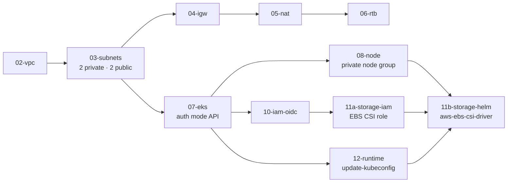
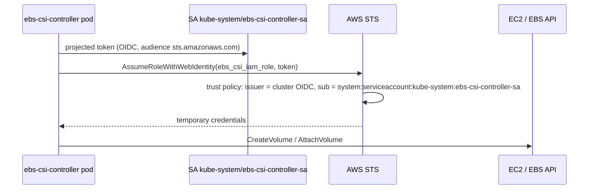
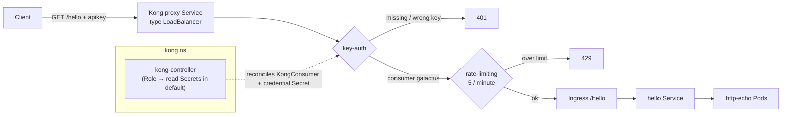

# Architecture

Diagrams for the EKS platform layer. Narrative: [`../README.md`](../README.md).

## Terraform build order

## IRSA trust for the EBS CSI driver

Nodes never hold EBS permissions. Only this ServiceAccount does.

## Kong request path

